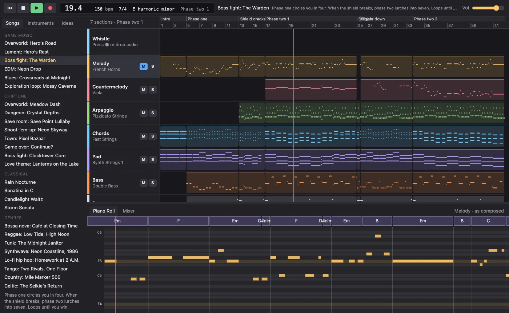

# Music Generator

I built Music Generator to make it simpler and easier to create music for the games I make.
It's a small DAW: projects of tracks and clips, a piano roll, a mixer, and sampled instruments.
On top of that it composes. Pick a feeling, a genre or one of its songs, or whistle a tune, and it
writes a new project: melody, countermelody, arpeggio, chords, pad, bass and drums, written by rule.

It's laid out like a DAW: a transport, a browser, an arrangement, a piano roll and a mixer.

## What it does

- **Keeps projects.** A project is a folder in `projects/` with a `project.json`: tracks,
  clips of notes, instruments, the mixer, tempo, meter, markers and a chord track. The 38 songs
  it ships with are projects you can open, edit and save.
- **Composes new projects.** **New…** writes one from a feeling, a genre or one of the songs. Each choice always comes out the same; **Roll** a seed for another song in that style, and type a seed back in to get it again.
  Twelve genre songs each tell a story, scene by scene: bossa nova, reggae, funk, synthwave,
  lo-fi hip hop, tango, country, celtic, chiptune, gospel, cinematic and blues, plus solo piano
  pieces with a left hand, rubato and ornaments. The game music loops; a boss fight switches
  into 7/4.
- **Plays them like a band.** Each composed track has a **Humanize** effect that adds ghost
  notes, swing, timing and ornaments as it plays, so every pass round a loop is a little different,
  and your edits are played the same way.
- **Edits.** Draw, move, resize and delete notes and their velocity in the piano roll, on a grid
  or free. Move, copy, split and delete clips, add and delete tracks, change the tempo and meter.
  Everything can be undone.
- **Turns whistling into notes.** Press record and whistle a melody over a click onto any track,
  vibrato included. Pick a stretch of the chord track and whistle a chord's notes to set the chord
  there. **New from melody** composes a band around the selected clip. A saved project keeps its
  takes in `projects/<name>/takes/`, and an audio file dropped on a track is read the same way.
- **Mixes.** Mute, solo, a fader and pan for every track, and any instrument from the libraries
  on any track: click it in the browser, or drag it onto the track.
- **Plays like an instrument.** Your computer keys or a MIDI keyboard, with velocity and a sustain
  pedal, play the selected track's instrument.

## Download

Get the latest version for your system from the [Releases](../../releases) page: macOS, Windows,
or Linux as a Flatpak. Nothing else needs installing. The first time you
open it, macOS or Windows may ask you to confirm; the [installing guide](docs/Installing.md) shows
how, and how to build it yourself.

## Controls

| | Keyboard | Mouse or MIDI |
| --- | --- | --- |
| Play and stop | `Space` | **▶** and **■**; **■** twice goes back to the start |
| Move the playhead | `,` `.` a bar back or on, `Alt ,` `Alt .` to the last or next marker, `Return` to the start, `End` to the end | click the ruler |
| Metronome | Transport ▸ Metronome | **♩** |
| Zoom the arrangement or piano roll | `Cmd =`, `Cmd -`, `Cmd 0` to fit | `Cmd` + scroll |
| New, save, save as | `Cmd N`, `Cmd S`, `Shift Cmd S` | **New…**, **Save**, **Save as** |
| Import a MIDI file as a new project (File menu), or drop one on a track to add its tracks from that bar | | |
| Export as audio (the whole project, the loop or the selection; the mix or each track as its own WAV; normalized if you like) or MIDI | `Cmd B`, `Cmd E` | |
| Undo, redo | `Cmd Z`, `Shift Cmd Z` | |
| Cut, copy, paste, duplicate (notes or a clip) | `Cmd X`, `Cmd C`, `Cmd V` (at the playhead), `Cmd D` | right-click, **Paste Here** |
| Loop | `C` loops the selection (or the section at the playhead), `Cmd U` moves the loop to it | drag along the ruler; right-click a clip, a marker or the ruler |
| Record a melody on the selected track | `R` starts and stops | **●** |
| Set a chord | drag over the chord track, then `R` and whistle its notes | |
| Draw a note | | click empty space in the piano roll; `Alt` turns off the grid |
| Move or resize a note | `↑` `↓` transpose, with `Shift` an octave | drag it, or drag its right edge |
| Select notes | `Cmd A` selects all, `Esc` none | `Shift` click adds or removes one, `Shift` drag on empty space adds a rectangle of them |
| Nudge notes (by the grid) or a clip (by a bar) | `←` `→` | |
| Humanize, double or half speed, reverse (notes or a clip) | Edit menu | right-click |
| Quantize notes or a clip | `Q`, to the grid | |
| Delete notes, a clip or a stretch of chords | `Delete` | |
| Move or copy a clip | | drag it; `Alt` drag copies it |
| Split a clip at the playhead, join it to the next | `Cmd T`, `Cmd J` | right-click, **Split Here** |
| Mute a clip | `M` | right-click, **Mute Clip** |
| Insert or delete bars at the playhead (everything after moves) | Edit menu | right-click the ruler |
| Change the tempo or meter from a bar on (a flag on the ruler shows each change) | | right-click the ruler, **Tempo Change Here…** or **Meter Change Here…**; right-click or double-click a flag to edit it, ramp to the next tempo, or remove it |
| New, duplicate or delete a track; move it | `Alt Cmd N`, `Shift Cmd D`, `Cmd Delete`; `Alt Cmd ↑` `↓` | right-click its header |
| Draw an empty clip | | double-click a track's lane |
| Play the selected track's instrument | `A S D F G H J K L ; '` white keys, `W E T Y U O P` black keys | a MIDI keyboard, with its sustain pedal |
| Octave down, up | `Z`, `X` | |
| Show or hide the browser | `B` | |
| Put an instrument on a track | | click it in the browser's Instruments tab, or drag it onto the track |
| Piano roll, mixer | `Cmd 1`, `Cmd 2` | |
| Follow the playhead, show other tracks' notes in the piano roll | View menu | |

Everything is also in the menu bar (File, Edit, Track, Transport, View), and right-clicking a clip, a lane, a track's header, the ruler, the chord track, a note, a mixer strip or anything in the browser shows what can be done to it: rename, colour, transpose, velocity, clip length, markers, tempo and meter, and more.

## Sound libraries

| Library | By | License |
| --- | --- | --- |
| [GeneralUser GS](https://github.com/mrbumpy409/GeneralUser-GS) 2.0.3 | S. Christian Collins | GeneralUser GS License v2.0: free for commercial music and software |
| FluidR3_GM | Frank Wen | MIT |
| MuseScore_General 0.2 | Frank Wen, Michael Cowgill and S. Christian Collins | MIT |

The app comes with GeneralUser GS and downloads the others when you press **Download** in the Instruments tab.
They aren't stored in this repository: `just soundfonts` downloads them, each with its license.

## Documentation

**[Installing](docs/Installing.md)**: which file to download, getting past the first-launch
warnings, the microphone, and where your projects go.

**[Read how it composes](docs/COMPOSING.md)**: the rules the composer follows and how to write
a song, for example:

- [How does a feeling turn into music?](docs/COMPOSING.md#2-from-emotion-to-parameters)
- [How do I write a song?](docs/COMPOSING.md#12-the-song-spec-writing-a-song)
- [What makes a funk song sound like funk?](docs/COMPOSING.md#13-genre-recipes)

## For developers

Setting up, checking your work, writing songs, composing from the command line, comparing
versions by ear and adding a library are covered in the
[developer guide](docs/Developer-Guide.md). The code layout and its rules are in
[ARCHITECTURE.md](docs/ARCHITECTURE.md).

## License

[MIT](LICENSE). The sound libraries have their own licenses, listed above.
